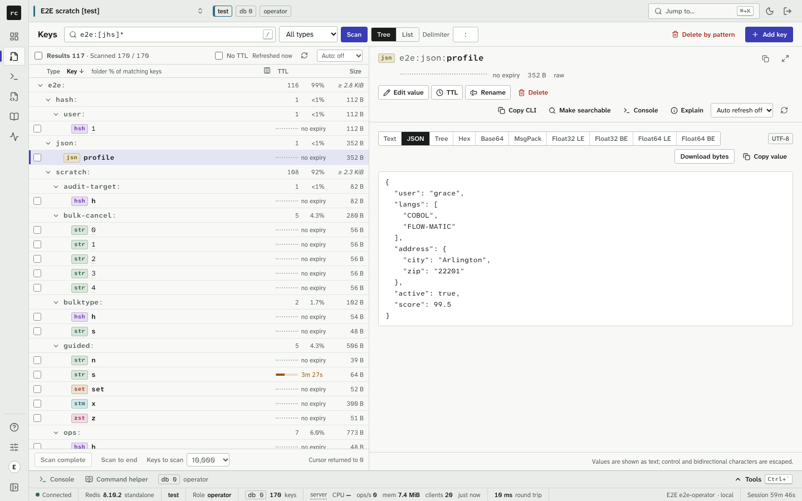
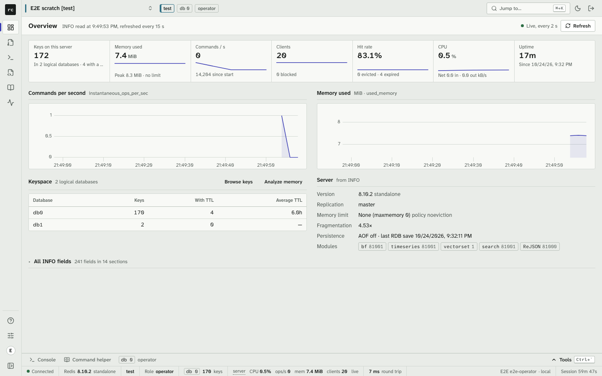
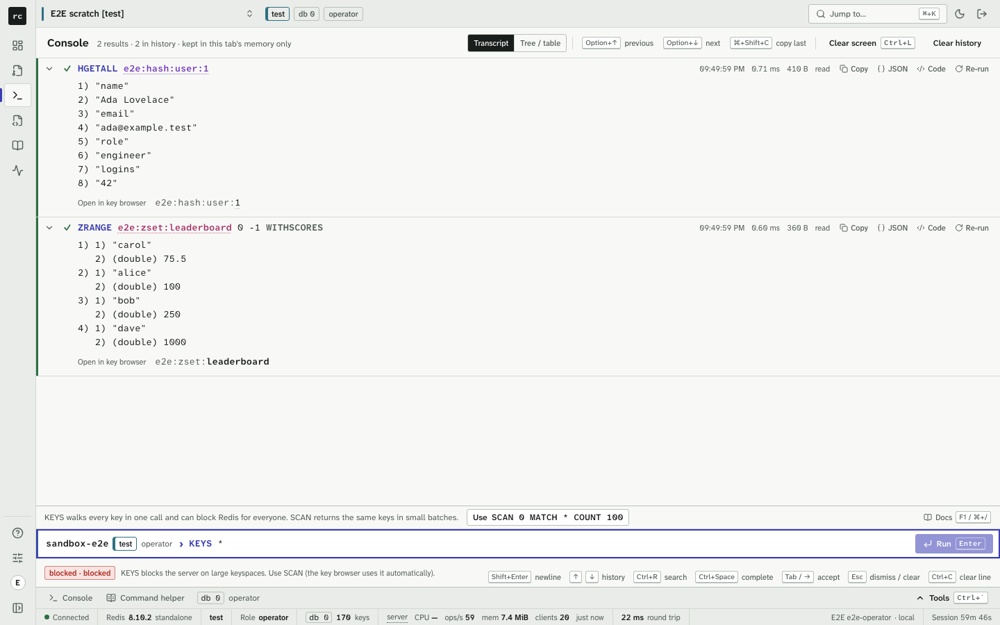
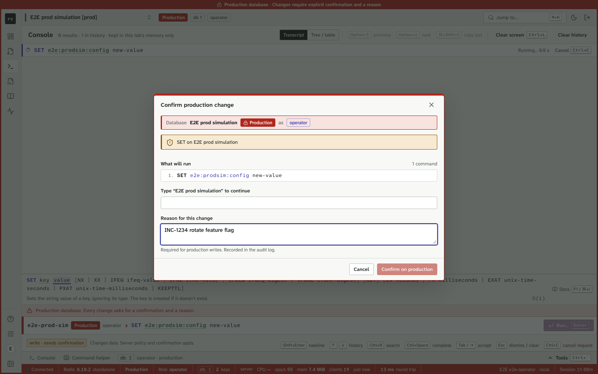
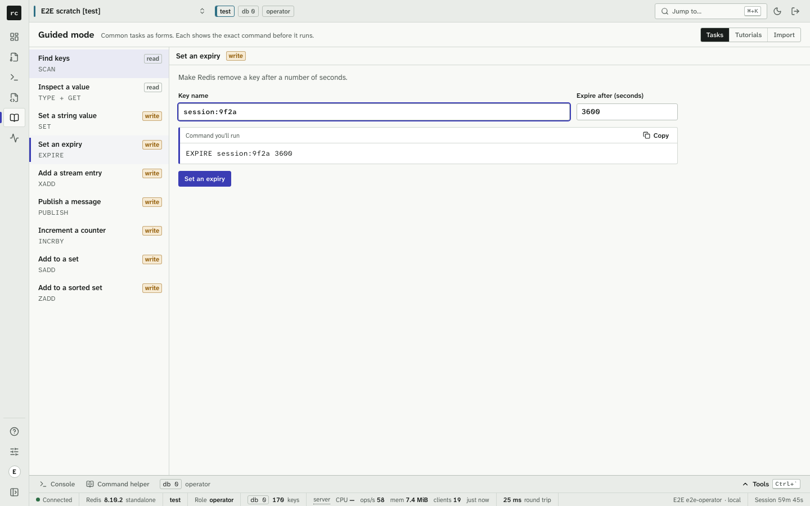
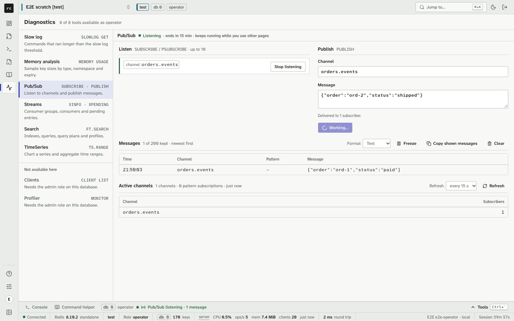
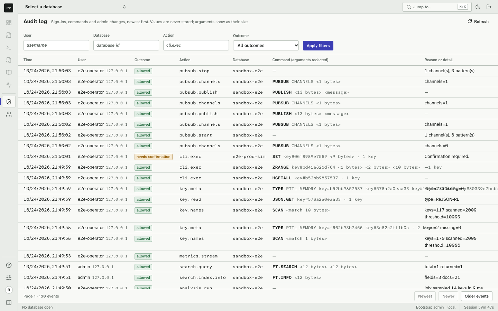

# Redis Console

A self-hosted, browser-based console for Redis that replaces Redis Insight and similar GUIs. Redis credentials and
connections live only on the server. Every command passes a server-side policy **and** runs as a Redis ACL user for
the caller's role, and everything is audited without storing values.



## Why it exists

Desktop and third-party Redis GUIs put production credentials on laptops or in the browser, let users point them at
any host, offer an unrestricted command line, and have no single sign-on, roles or audit trail; some send data to
outside services. Redis Console exists because **credentials and data must never live in the browser or in a
third-party desktop app**. Security is the product; the reasons for each design choice are in
[docs/DECISIONS.md](docs/DECISIONS.md).

- **No secrets in the browser.** The browser gets an HttpOnly, `SameSite=Strict` session cookie and a CSRF token.
  Databases (hosts, TLS, credentials) are server configuration referenced by id; secrets are `{env}`/`{file}` references.
- **Two enforcement layers.** A fail-closed command policy (read, write, admin, blocked; unknown commands are blocked;
  Lua, `KEYS`, `FLUSHALL`, `CONFIG SET`, `MODULE`, `MULTI` are blocked for everyone), and one Redis ACL user per role
  underneath. Effective role = min(user role, database max role); read-only databases refuse every write.
- **Safe by default.** Destructive actions are confirmed against a preview the server builds of the exact commands.
  Every production write needs the typed database name and a reason. Edits are compare-and-set, so a concurrent
  change is never silently overwritten.
- **Sign-in.** OIDC (code + PKCE) with group-to-role mapping, and local accounts with argon2id, lockout and TOTP
  (seeds encrypted at rest).
- **Audit.** Every sign-in, command and read is recorded with redacted arguments (key hashes, byte counts) and written
  as JSON lines for your SIEM.
- **Hardened browser.** Strict CSP with a per-request nonce and Trusted Types, no CORS, no framing. Redis data is
  shown as text, byte-exact, never as HTML.
- **Nothing leaves.** No telemetry, no AI, no external calls besides Redis and your identity provider.

## Features

- **Key browser:** names-only scanning that shows the whole namespace tree with counts and shares in under a second;
  type, TTL and size loaded for visible rows; every Redis type plus JSON, TimeSeries, Bloom/Cuckoo and streams;
  formatters (JSON, hex, base64, MessagePack, gzip/deflate, inert Java/PHP structure views); binary-safe keys;
  delete by pattern as a cancellable job.
- **Console and workbench:** redis-cli syntax with autocomplete, inline docs and a policy badge before you press Enter;
  terminal-style shortcuts; scripts with per-line results; search results as tables, time series as charts.
- **Guided mode:** forms for everyday tasks that show the exact command, offline tutorials, and policy-checked
  command-file import.
- **Diagnostics:** live dashboard and status-bar metrics, slow log, memory analysis with recommendations, Pub/Sub,
  stream consumer groups, RediSearch index wizard and query editor, TimeSeries charts, client list, and a time-boxed
  profiler (admins, non-production).
- **Tools drawer** with Console, Command helper and Profiler on every database page; audit log and local user
  management for admins.

| | |
|---|---|
|  |  |
| Dashboard | Console: `KEYS *` is blocked before you run it |
|  |  |
| Production writes: typed name and reason | Guided mode shows the exact command |
|  |  |
| Live Pub/Sub | Audit log with redacted arguments |

Screenshots show sandbox fixtures only.

## Try it locally (about five minutes)

Requirements: Node ≥ 24.11, pnpm 11 (`corepack enable`), Docker.

```bash
git clone https://github.com/SaiBarathR/redis-console.git && cd redis-console
pnpm install
bash scripts/dev-setup.sh              # creates .env (gitignored) with random secrets; starts Redis 8 sandboxes + Keycloak
pnpm --filter @rconsole/web build      # the server serves the built web app
pnpm --filter @rconsole/server dev     # http://localhost:4000 (reads .env itself)
```

For hot reload while you work on the code, run `pnpm dev` instead of the last two lines: it starts the server and
the Vite dev server together and prints the address to open (http://localhost:5173; `RCONSOLE_PORT` and
`RCONSOLE_WEB_PORT` change the ports).

Open http://localhost:4000 (or the `pnpm dev` address) and choose **Continue with Company SSO (dev Keycloak)**. Sign in as `viewer1`, `operator1` or `admin1`
with the password in `KC_USER_PASSWORD` in `.env` (`nogroup1` is refused: no role). Or sign in locally as `admin`
with `BOOTSTRAP_ADMIN_PASSWORD`: you'll be asked to change the password and enroll an authenticator app.

The sandbox has three Redis 8 databases on 127.0.0.1, each with `rc-viewer`, `rc-operator` and `rc-admin` ACL users:
`sandbox-main` (6410), `sandbox-e2e` (6411) and `snapshot` (6412). They start empty; add keys in the app, or copy a
Redis you are allowed to replicate into `snapshot` with
`scripts/snapshot-redis.sh --host H --port P --password-env VAR`. They are yours to break; reset them with
`bash scripts/dev-setup.sh --reset-data`.

## Deploy

[docs/INSTALL.md](docs/INSTALL.md) covers Docker, Docker Compose, Kubernetes and plain Node with systemd, a TLS reverse
proxy (Caddy, nginx), identity providers (Keycloak, Entra ID, Okta, Google), the Redis ACL users, secrets, a minimal
production config, the first sign-in, backups, upgrades and a hardening checklist.

## Documentation

| Document | For |
|---|---|
| [docs/INSTALL.md](docs/INSTALL.md) | Deploying on any server |
| [docs/OPERATIONS.md](docs/OPERATIONS.md) | Configuration reference and day-2 operations |
| [docs/USER-GUIDE.md](docs/USER-GUIDE.md) | People using the console, including those new to `redis-cli` |
| [docs/ARCHITECTURE.md](docs/ARCHITECTURE.md) | How it works: request lifecycle, policy, transport, auth, audit, web app |
| [docs/DECISIONS.md](docs/DECISIONS.md) | Why it works that way |
| [docs/SECURITY.md](docs/SECURITY.md) | Threat model, controls and their tests, reporting a vulnerability |
| [AGENTS.md](AGENTS.md), [CONTRIBUTING.md](CONTRIBUTING.md) | Working on the code (agents and humans) |
| [docs/README.md](docs/README.md) | Index of every document, including history |

## Tests

```bash
pnpm -r typecheck
pnpm test             # unit and integration tests (server integration uses the sandbox)
pnpm test:e2e         # Playwright end-to-end and API security suite
```

The end-to-end suite runs the real server with the built SPA in the production-style setup, against disposable Redis
8 containers and Keycloak. It covers authentication, a route × role matrix, CSRF, headers and CSP (it fails on any
violation), a leak scan of every response and of the server log, XSS fixtures, blocked commands, read-only and
production rules, confirmations, rate limits and every UI feature. See [tests/e2e/README.md](tests/e2e/README.md).

## Status and license

Version **0.4** (tag `v0.4`, image `ghcr.io/saibarathr/redis-console:0.4.0`). Release notes:
[docs/RELEASE-NOTES-v0.4.md](docs/RELEASE-NOTES-v0.4.md) (earlier: [v0.3](docs/RELEASE-NOTES-v0.3.md),
[v0.2](docs/RELEASE-NOTES-v0.2.md)). The public history starts at
v0.3; earlier releases were developed privately. Single instance per data directory; see the known
limitations in [docs/SECURITY.md](docs/SECURITY.md#known-limitations).

Licensed under the [Apache License 2.0](LICENSE). See [NOTICE](NOTICE) and [THIRD-PARTY-NOTICES](THIRD-PARTY-NOTICES) for
third-party components (regenerate the latter with `node scripts/third-party-notices.ts` after changing dependencies).
