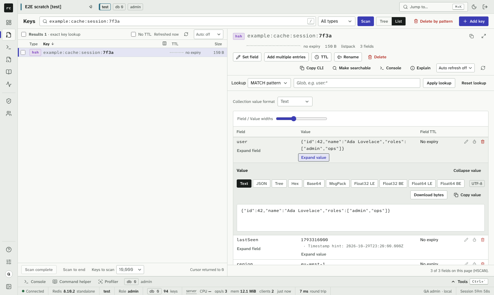
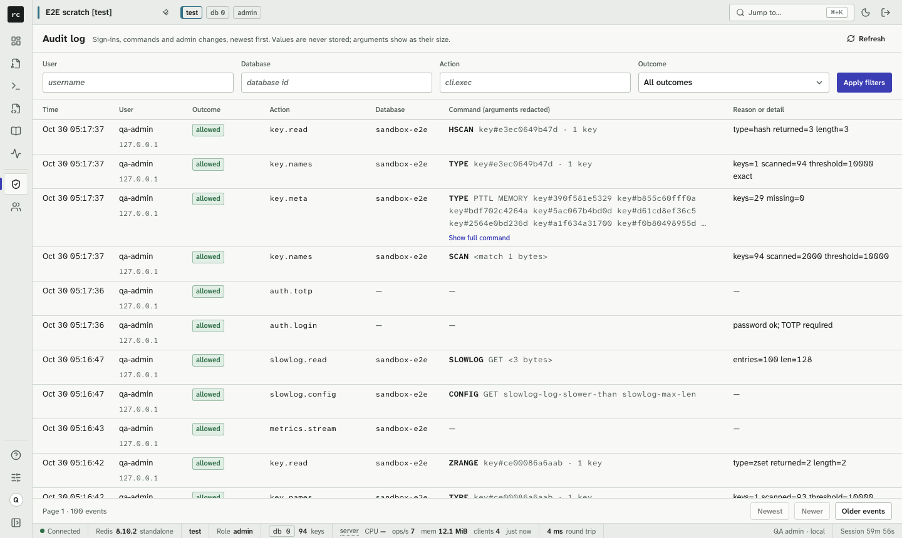

# Redis Console v0.4.3

The details inside every control: padding, insets, heights and focus rings, checked by a new automated test on every
page instead of by eye alone.

## Fixes

- **Selects.** Every select draws one chevron, inset 9 px from its border (6 px on compact selects), with its text
  kept clear of it. The native arrow used to sit on the border.
- **Rows of controls.** Buttons, inputs and selects that share a row now have one height, and checkboxes keep a gap to
  their labels.
- **Text inside chips and tags.** Policy, database, topic, outcome and role tags, user status labels, the Redis type
  glyph, key-count chips and sortable column headers keep their text clear of their edges.
- **Focus.** Keyboard focus rings are no longer cut off inside control groups, and the database picker rows show one.
- **Console.** The docked console fits the tools drawer, and autocomplete options, gutter markers and row icons are
  padded.
- **Collections.** The "Expand field" and "Expand value" toggles line up with the cell text, and clipped previews end
  in an ellipsis.
- **Tables.** In the users table, Manage keeps a margin from the edge, and long index names wrap inside their cell.
  Audit usernames, stream entry IDs and key counts stay on one line. The key tree's header reads "folder %", with its
  meaning in the tooltip.
- **Overview.** The summary readouts no longer leave a lone last word ("limit", "kB/s") on its own line.

## How it was checked

- **A permanent control anatomy test** (`tests/e2e/specs/ui/anatomy.spec.ts`). It covers every page and state at 1024
  and 1440 px, in light and dark. For every button, input, select, tab, badge, chip and bordered element it measures:
  text and icon insets, the select chevron's inset, the gap between icon and label, equal heights within a row, clipped
  text, focus rings, and controls wider than their cell. Before the fixes it found over 400 violations (counted once per page state) across 348 page
  states; now it finds none, and it runs in CI, so these mistakes fail the build from now on. Details:
  [qa/v043-ui-anatomy.md](qa/v043-ui-anatomy.md).
- **Zoomed review.** 2x contact sheets of every distinct control were reviewed, and two independent 2x screenshot
  reviews followed: GPT-6.1 Sol, and the release integrator. Each finding was fixed.
- **Tests.** `pnpm -r typecheck` clean; web 559 passed; the full Playwright suite 720 passed, 0 failed, 0 flaky,
  2 skipped.

## Upgrade notes

- No configuration, API or data changes. Upgrade by replacing the image (back up the data directory first, as
  always).
- Automation: the key tree's `key-share-note` now reads "folder %", and its `title` carries the full meaning
  ([TESTIDS.md](../apps/web/TESTIDS.md)).
